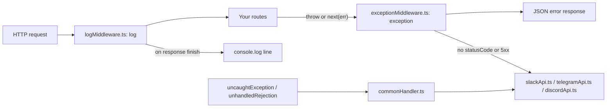

<div align="center">


# shazam-middleware

**Express middleware that logs every request and alerts your team when an error happens.**<br/>
One line per request: method, status, URL, IP, response time, and browser.

[](https://app.codacy.com/gh/juninmd/shazam-middleware/dashboard)
[](https://npmjs.org/package/shazam-middleware)
[](https://npmjs.org/package/shazam-middleware)
[](https://github.com/juninmd/shazam-middleware/issues)
[](https://github.com/juninmd/shazam-middleware/network)

</div>

> Add `shazam.log` and `shazam.exception` to your Express app, pass your Slack, Telegram, or Discord settings, and each request is logged while errors are sent to your channel.

## What is shazam?
* Shazam is an `express` middleware.

## What it does
* HTTP request logger: method, status code, URL, IP, response time, and browser, printed to the console.
* Error notifications on Slack, Telegram, or Discord when an error reaches the exception middleware, and when a process-level `uncaughtException` or `unhandledRejection` happens.
* JSON error responses with a developer message, a user message, the route, the date, and the stack trace (see [Known limitations](#known-limitations)).

## Install
Requirements: [Node](https://nodejs.org/en/) and [Express](https://www.npmjs.com/package/express).

```bash
npm install --save shazam-middleware
```
or
```bash
yarn add shazam-middleware
```

## Configuration
Pass the options to the factory. Only the blocks for the channels you use are needed.

| Option | Purpose | Required | Default | Example |
|---|---|---|---|---|
| `api.name` | Application name in Slack messages | Slack only | none | `'My App'` |
| `api.version` | Application version in Slack messages | Slack only | none | `1` |
| `env` | Source of the `Environment` field in alerts (`NODE_ENV`) | no | `process.env` | `process.env` |
| `slack.urlHook` | Slack incoming webhook URL | Slack only | none | read from your environment |
| `slack.channel` | Channel name, without `#` | Slack only | none | `'alerts'` |
| `slack.botusername` | Bot display name | no | `Shazam` | `'Shazam'` |
| `slack.iconUrl` | Bot icon URL | no | a URL in `bin/api/slackApi.ts` that currently returns 404 | `'https://example.com/icon.png'` |
| `telegram.botToken` | Telegram bot token | Telegram only | none | read from your environment |
| `telegram.chatId` | Chat that receives alerts | Telegram only | none | `'-1000000000000'` |
| `discord.webhookUrl` | Discord webhook URL | Discord only | none | read from your environment |
| `discord.username` | Webhook display name | no | webhook default | `'Shazam'` |
| `discord.avatarUrl` | Webhook avatar URL | no | webhook default | `'https://example.com/avatar.png'` |

> [!WARNING]
> Webhook URLs and bot tokens are secrets. Read them from environment variables, as in the example below, and never commit them.

### Slack
* Activate the Incoming Webhooks app on Slack to get your webhook URL: `https://{yourslackname}.slack.com/apps/A0F7XDUAZ-incoming-webhooks`
* Docs: https://api.slack.com/incoming-webhooks

## Usage
```js
const app = require('express')();

// Don't forget to configure the paramters
const shazam = require('shazam-middleware')({
    slack: {
        urlHook: process.env.urlHook,
        channel: process.env.channel,
        iconUrl: process.env.iconUrl,
        botusername: process.env.botusername
    },
    api: {
        name: 'My App',
        version: 1
    }
});

// `shazam.handler` is a no-op access: the process handlers are registered by the factory call above
shazam.handler;

// Now, we wanna log all requests
app.use(shazam.log);

// Look Here, one route with error
app.get("/error", (req, res, next) => {
    batata
    res.status(200).send({ retorno: 'ok' })
})

// Now, we will look for all exceptions from ours routes
app.use(shazam.exception);

// Start the Server
app.listen(4600, () => {
    console.log('APP WORKS http://localhost:4600')
})
```

Output of the example above after `curl http://localhost:4600/error` (excerpt):

```text
[ShazaM] Handlers Activated
APP WORKS http://localhost:4600
[ShazaM] Common Error: batata is not defined
[ShazaM] GET | 500 | http://localhost:4600/error | IP: ::ffff:127.0.0.1 | Response: 7 ms | Browser: ? 
```

To report a handled error, pass an object with `message` and `statusCode` to `next()`:

```js
app.get("/error/next", (req, res, next) => {
    next({
        message: {
            userMessage: 'Hey, user! Don´t Worry',
            developerMessage: 'Hey Man! This is bad'
        },
        statusCode: 500
    });
})
```

<!-- TODO(screenshot): Slack alert for a 500 error, using fictitious channel and data -->

## How it works


* The request line is written when the response finishes (`on-finished`), so each request logs once, including failed ones.
* Notifications are sent with a plain `fetch` call in `bin/api/baseApi.ts`. A failed delivery is printed to the console and does not change the response.
* `handler.ts` registers the process listeners when the factory runs, so no extra setup is needed.

## Develop
Requires Bun (the tests use `bun:test`; tested with 1.3.13).

```bash
bun install   # install dependencies and update bun.lock
bun test      # run test/testApp.test.ts against the Express test app
```

> [!WARNING]
> `bun.lock` is out of sync with `package.json`, so `bun install --frozen-lockfile` fails until the lockfile is regenerated.

## Known limitations
* Errors thrown or passed to `next()` as `Error` objects return `details.stack` in the response, with the full stack trace and file paths. Remove or filter that field before the app runs in production.
* Notifications are sent only for errors with no status code or a 5xx status. Errors with 4xx status are logged but not sent.
* Telegram and Discord delivery is implemented but not covered by tests. Verify it with your own credentials before relying on it.
* The default Slack icon URL returns 404. Set `slack.iconUrl` to a URL you control.
* Logs go to the console only. Saving requests to a database is not implemented yet (MongoDB was under consideration).
* Lazy-request checks are not implemented yet.
* Tested with Express 5 only.

## License
MIT, as declared in `package.json` (author: Antonio Carlos). The repository has no `LICENSE` file yet.
